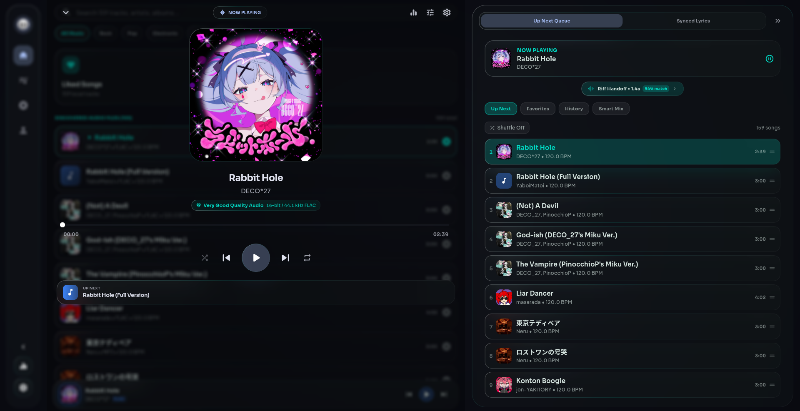
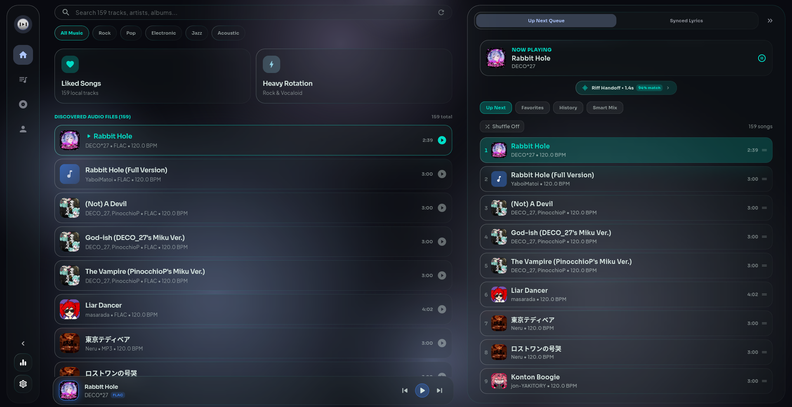
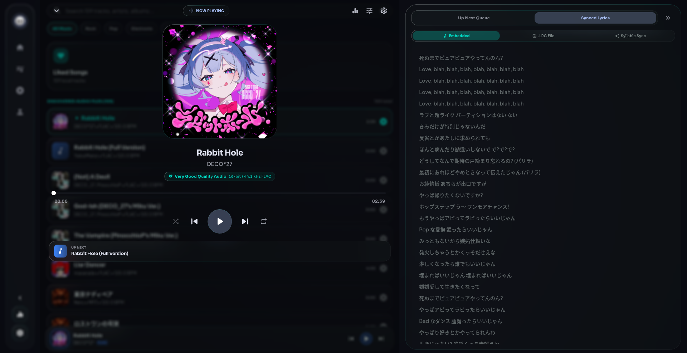
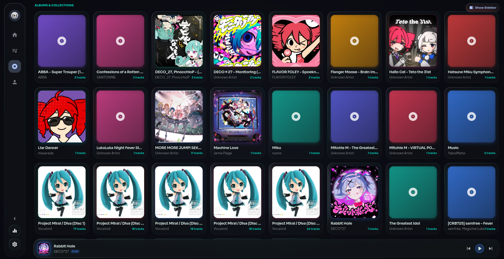
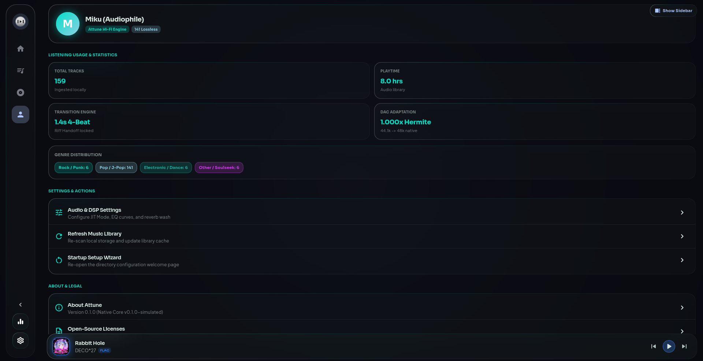

<div align="center">


# Attune

**Open-Source Music Player with an Audio-Profile Driven Transition Engine & Studio Master Rack**

[](LICENSE)
[](https://www.rust-lang.org/)
[](https://flutter.dev/)
[]()
[](https://github.com/Mizumo-prjkt/attune/actions/workflows/build_and_release.yml)

</div>

---

## Overview

**Attune** is a modern, open-source local music player engineered for seamless listening. Instead of relying solely on static metadata tags or primitive crossfaders, Attune couples a native Rust digital signal processing (DSP) core with a responsive Flutter user interface. 

The player continuously analyzes incoming and outgoing audio tracks across five acoustic profiling dimensions—pitch sustain contours, local harmonic chroma, phrase grids, frequency-split spectral dynamics, and an aggression index—to automatically synthesize harmonic, beat-aligned transitions between consecutive songs.

Attune includes an integrated 10-band master equalizer, audio focus ducking, syllable-synchronized karaoke lyrics, and a unified cross-platform build studio supporting Linux AppImages, Windows Inno Setup installers, and Android APKs.

---

## Showcase

<div align="center">

### Now Playing Stage & Liquid Glass Visuals
*Dynamic ambient glassmorphism with album art glow, track controls, and live transition preview badges.*
<br/>


<br/><br/>

### Interactive Music Library & Multi-Deck Queue
*Collection browsing with genre filters, track discovery, and cue zone match indicators.*
<br/>


<br/><br/>

### Syllable-Synchronized Karaoke & LRC Lyrics Engine
*Synchronized lyrics rendering with real-time glowing progress, syllable alignment, and source toggling.*
<br/>


<br/><br/>

### Visual Albums & Artists Browser
*Rich grid browsing of albums and artists across the local music library.*
<br/>


<br/><br/>

### Audiophile Telemetry & Transition Engine Statistics
*DAC adaptation monitoring (Hermite resampling, native sample rates), playback metrics, and genre distribution.*
<br/>


</div>

---

## Technical Highlights

### 1. Five-Layer Audio Profiling Core
Attune's headless Rust analysis crate (`attune-core`) extracts multi-dimensional audio profiles within candidate intro/outro Cue Zones:
- **Micro-Pitch & Sustained Contour ($f_0$)**: Tracks fundamental vocal sustains and formants ($F_1/F_2$) to detect harmonic vocal handoffs.
- **Local Harmonic Chroma (12-bin CQT)**: Calculates real-time tonal chord progressions and pitch-class distributions.
- **Dynamic Rhythm & Phrase Grid**: Detects tempo, beat markers, downbeats, and 4/8/16-bar phrase boundaries.
- **Band-Split Spectral Energy**: Analyzes energy distribution across Sub/Bass (20–150 Hz), Low-Mid (150–600 Hz), Vocal/Presence (600–4k Hz), and Air (4k–20k Hz).
- **Aggression & Drive Index ($\mathcal{A} \in [0, 1]$)**: Detects instrumentation signatures (distorted guitar, heavy percussion, vocal grit) to dynamically adapt transition pace between aggressive rock and mellow acoustic genres.

### 2. Dual-Deck Transition & Remixing Engine
- **Hermite S-Curve & Equal-Power Crossfades**: Prevents mid-transition perceived volume dips.
- **Bass Swap & Frequency Split Handoff**: Crossfades low-end frequencies independently to prevent phase cancellation and muddy bass buildup.
- **Vocal Morph & Drop Cut**: Exploits vocal sustain tails and drum breakdown cue points for instantaneous transitions.
- **Smart Shuffle with Rationale Verdict**: Evaluates queue candidates against the currently playing track and surfaces an interactive rationale modal explaining why a specific song won and listing viable alternatives.

### 3. Attune Studio Master FX Rack
- **10-Band Biquad Graphic Equalizer**: Zero-latency peaking and shelving filters (31 Hz, 62 Hz, 125 Hz, 250 Hz, 500 Hz, 1 kHz, 2 kHz, 4 kHz, 8 kHz, 16 kHz) with ±12 dB gain adjustment.
- **Dynamic Factory Presets**: Flat, Bass Boost, Vocal Enhance, Treble Boost, Rock/Metal, Electronic/EDM, Acoustic/Classical, and Speech/Podcast.
- **Master Effects**: Pure Bass+ sub-harmonic enhancer, Vocal Clarity exciter, Stereo Width field expander, and lookahead soft limiter to prevent output clipping.

### 4. Cross-Platform Standalone Build Studio (`tools/builder.py`)
- **Simultaneous Dual-Mode Builds (`--mode both`)**: Packages both `release` (optimized production binaries) and `debug` (unstripped binaries with full symbol logging) simultaneously, enabling contributors to inspect logs, submit stack traces, and test features.
- **Interactive Tkinter Desktop GUI**: Graphical control panel to assess host toolchains, etch compiler metadata, generate patch notes, and package standalone targets.
- **In-App GitHub Release Update Checker**: Built-in `UpdateService` queries the GitHub Releases API, checks semantic version tags, displays changelogs, and offers direct asset downloads for host platforms.

---

## Project Structure

```
attune/
├── apps/
│   └── attune_app/               # Flutter desktop & mobile application
│       ├── lib/                  # UI stages, services, and liquid glass theme
│       ├── test/                 # Comprehensive unit & widget test suite
│       └── android/              # Native Android wrapper and JNI bindings
├── crates/
│   ├── attune-core/              # Audio profiling, DSP math, chroma, and cue zones
│   └── attune-ffi/               # C-ABI export layer linking Rust to Flutter
├── ledger/                       # Strict Knowledge Ledger & ADR repository
│   ├── 00_MASTER_LEDGER.md       # Phase roadmap, active tasks, and status
│   ├── 01_ADR_LOG.md             # Architecture Decision Records (ADR 001–035)
│   ├── 02_DSP_ALGORITHM_SPEC.md  # Detailed transition mathematics and cue math
│   └── 04_TRANSITION_LAB_LOG.md  # Empirical audio transition tuning benchmarks
├── packaging/
│   ├── linux/                    # Linux AppImage assembly scripts & AppDir template
│   └── windows/                  # Inno Setup (.iss) installer scripts
├── screenshot_showcase/          # Showcase screenshots of the application
└── tools/
    └── builder.py                # Unified Python build & packaging orchestrator
```

---

## Building from Source

### Prerequisites

| Tool | Recommended Version | Purpose |
| :--- | :--- | :--- |
| **Rust & Cargo** | Stable 1.80+ | Native DSP core & FFI compilation |
| **Flutter SDK** | Stable 3.24+ | Application UI & responsive shell |
| **Python** | 3.10+ | Build orchestration & Tkinter GUI studio |
| **Android NDK** | r26+ (API 26+) | *Optional:* Cross-compilation for Android |
| **appimagetool** | Latest | *Optional:* Building Linux AppImages |
| **Inno Setup 6** | 6.2+ | *Optional:* Building Windows installers |

### Quick Build (Headless CLI)

Clone the repository and run the unified build orchestrator:

```bash
git clone https://github.com/Mizumo-prjkt/attune.git
cd attune

# 1. Assess host toolchains
python3 tools/builder.py --no-gui --step assess

# 2. Build for Linux (Release + Debug simultaneous packaging)
python3 tools/builder.py --no-gui --target linux --mode both --step all

# 3. Build for Android APK (Release)
python3 tools/builder.py --no-gui --target android --mode release --step all
```

Compiled packages and standalone bundles are output directly to `dist/<target_os>/`.

### Interactive GUI Build Studio

To launch the graphical build studio, simply run:

```bash
python3 tools/builder.py --gui
```

From the studio interface, you can select target operating systems, choose compilation modes (`Release`, `Debug`, or `Both`), override version strings, inspect live compiler logs, and package bundles with one click.

---

## Architecture Decision Records & Knowledge Ledger

To maintain context and architectural integrity across developer and AI sessions, this project adheres to the **Attune Knowledge Ledger Protocol** under `ledger/`:

- [`ledger/00_MASTER_LEDGER.md`](ledger/00_MASTER_LEDGER.md): Master phase tracking, locked architectural decisions, and current priorities.
- [`ledger/01_ADR_LOG.md`](ledger/01_ADR_LOG.md): Architectural Decision Records (ADRs 001–035) covering DSP crates, FFI bridges, packaging formats, zero-hardcoding mandates, and update APIs.
- [`ledger/02_DSP_ALGORITHM_SPEC.md`](ledger/02_DSP_ALGORITHM_SPEC.md): Algorithmic formulas for 5-layer audio profiling, Hermite interpolation, and beat alignment.
- [`ledger/04_TRANSITION_LAB_LOG.md`](ledger/04_TRANSITION_LAB_LOG.md): Empirical test logs evaluating real audio transitions across genres.

---

## AI Collaboration Disclosure

Attune is developed by **Mizumo-prjkt** in open, transparent pair programming with Google DeepMind’s **Gemini 3.8 Flash** (via Google Antigravity) alongside **Claude**.

All mathematical formulas, memory bounds, DSP routines, and UI implementations are designed with a strict **Zero-Hardcoding Mandate**—ensuring that dynamic system metrics, real audio analysis, and operating system attributes govern behavior rather than arbitrary static heuristics.

---

## Credits & Upstream Open Source

Attune builds upon foundational work from the open-source audio and systems programming community:

- **[Signalsmith Stretch](https://github.com/Signalsmith-Audio/signalsmith-stretch)**: Pitch-shift and time-stretch DSP engine.
- **[Symphonia](https://github.com/pdeljanov/Symphonia)**: Pure Rust audio decoding and multimedia demuxing.
- **[cpal](https://github.com/RustAudio/cpal)**: Cross-platform native audio hardware I/O.
- **[rubato](https://github.com/HEnquist/rubato)**: High-performance sample rate converter.
- **[Hound](https://github.com/ruuda/hound)**: WAV encoding and decoding.
- **[Flutter](https://flutter.dev/) & [Dart](https://dart.dev/)**: Multi-platform user interface framework.

---

## Community & Sponsorship

Attune is an independent open-source project. If you find Attune useful or would like to support ongoing development, hardware testing, and DSP research, community sponsorship options will be available soon. Please follow the repository for release announcements and progress updates.

---

## License

Attune is distributed under the **[MIT License](LICENSE)**.

Third-party dependencies and linked libraries carry their own respective open-source licenses, including BSD-2-Clause, BSD-3-Clause, Apache-2.0, MIT, MPL-2.0, LGPL, and GPL.
